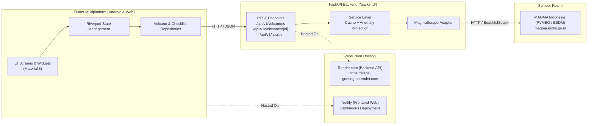

# 🌋 SiagaGunung

Aplikasi Informasi Aktivitas dan Edukasi Kesiapsiagaan Mitigasi Gunung Api Multi-Platform (Android & Web).

---

## 🏗 Arsitektur Sistem

Aplikasi dibangun dengan arsitektur bersih multi-platform:



---

## 🚀 Fitur Utama

1. **Daftar Gunung Dinamis (69+ Gunung Api):**
   - Menampilkan seluruh data gunung api aktif dari MAGMA Indonesia secara real-time.
   - Diurutkan hierarkis: **Level IV (Awas) → Level III (Siaga) → Level II (Waspada) → Level I (Normal)**, dan alfabetis per tingkatan.
2. **Pencarian, Filter Wilayah & Favorit:**
   - Pencarian instan berdasarkan nama gunung atau lokasi.
   - Filter kepulauan (Sumatera, Jawa, Bali & Nusa Tenggara, Sulawesi, Maluku).
   - Filter level aktivitas (Awas, Siaga, Waspada, Normal).
   - Tandai / Sematkan Gunung Api Favorit (disimpan persisten di perangkat).
3. **Peta Interaktif Sebaran Gunung Api (Interactive Map):**
   - Didukung oleh OpenStreetMap (`flutter_map`) dengan 69 koordinat presisi.
   - Marker berkode warna dinamis sesuai tingkat aktivitas, animasi berdenyut untuk status Awas/Siaga.
   - Lingkaran estimasi Radius Rekomendasi Bahaya (1.5 km s/d 7 km).
4. **Deteksi Gunung Terdekat (Geolokasi GPS):**
   - Mendeteksi posisi pengguna secara otomatis dan menghitung jarak radius terdekat ke gunung api aktif.
5. **Detail Aktivitas On-Demand & Scraping Dinamis:**
   - Mengambil laporan detail langsung dari MAGMA Indonesia saat dibuka pengguna.
   - Menampilkan visual kawah, periode pengamatan, data seismik/kegempaan, klimatologi, dan rekomendasi resmi PVMBG.
   - Banner Peringatan Status Tinggi di Beranda untuk gunung dengan status Awas/Siaga.
6. **Proteksi Integritas & Anomali Data:**
   - In-memory caching: 30 menit (list) dan 60 menit (detail).
   - Proteksi penurunan drastis (>20%) untuk mencegah data hilang saat situs sumber mengalami gangguan.
7. **Modul Edukasi Mitigasi & Tas Siaga 72 Jam (TSB):**
   - 7 modul resmi panduan mitigasi bersumber dari BNPB & PVMBG.
   - Checklist Perlengkapan Darurat interaktif dengan penyimpanan lokal (`SharedPreferences`).
   - Bagikan laporan status dan ekspor checklist kesiapsiagaan (`share_plus`).

---

## 💻 Cara Menjalankan Secara Lokal

### 1. Menjalankan Backend FastAPI

```bash
cd backend

# Aktifkan virtual environment
source .venv/bin/activate  # Linux / macOS
# atau: .venv\Scripts\activate  (Windows)

# Jalankan server lokal
uvicorn main:app --reload --host 0.0.0.0 --port 8000
```
- Dokumentasi API Swagger UI: `http://localhost:8000/docs`
- Unit Test: `pytest -v`

### 2. Menjalankan Frontend Flutter

```bash
# Pastikan dependencies terpasang
flutter pub get

# Jalankan Web (server mandiri, kompatibel dengan browser apa pun)
flutter run -d web-server --web-port 8080
# Buka http://localhost:8080 di browser (Chrome / Firefox / Edge)

# Jalankan di Android Emulator / Device
flutter run -d android
```

---

## 📦 Build & Deployment

### Backend (Production URL)
Backend production saat ini di-hosting di Render:
- Base URL: `https://siaga-gunung.onrender.com`
- Swagger UI: `https://siaga-gunung.onrender.com/docs`

### Build Web Statis (Netlify / Vercel / GitHub Pages)
Aplikasi web secara otomatis terhubung ke backend Render saat di-build dalam mode release:
```bash
flutter build web --release
```
Hasil build berada di direktori `build/web/`. Proyek ini sudah dilengkapi dengan:
- [`netlify.toml`](file:///home/light/Dev/flutter/siaga_gunung/netlify.toml) untuk auto-build dan SPA routing di Netlify.
- `_redirects` untuk mengatasi rute SPA 404.

### Build APK Android
```bash
flutter build apk --release
```
*(Opsional menentukan URL custom: `--dart-define=API_URL=https://alamat-api-anda.com`)*

### Menjalankan via Docker Compose
```bash
docker-compose up -d --build
```
- Web: `http://localhost:8080`
- Backend API: `http://localhost:8000`

---

## 📌 Informasi Sumber & Lisensi Scraper

- **Sumber Data Resmi:** [MAGMA Indonesia (PVMBG - Badan Geologi Kementerian ESDM)](https://magma.esdm.go.id/)
- **Scraper Reference:** [Gabrielbjb/Magma-Indonesia-API](https://github.com/Gabrielbjb/Magma-Indonesia-API) (Pinned Commit: `d565a3c`)
- **Lisensi:** Open Source untuk edukasi mitigasi kebencanaan masyarakat.
