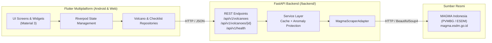

# 🌋 SiagaGunung

Aplikasi Informasi Aktivitas dan Edukasi Kesiapsiagaan Gunung Api (Android & Web).

---

## 🏗 Arsitektur Sistem

Aplikasi dibangun dengan arsitektur bersih multi-platform:



---

## 🚀 Fitur Utama (Sesuai PRD v1.4)

1. **Daftar Gunung Dinamis (FR-02, AC-03):**
   - Menampilkan seluruh entri aktif dari MAGMA Indonesia (bukan hardcode 3 gunung).
   - Diurutkan hierarkis: **Level IV (Awas) → Level III (Siaga) → Level II (Waspada) → Level I (Normal)**, dan alfabetis per level.
   - Level kosong tetap ditampilkan dengan jumlah 0 dan empty state informatif.
2. **Pencarian & Filter Level (FR-03, AC-17):**
   - Pencarian real-time berdasarkan nama gunung atau provinsi.
   - Filter chip interaktif per level dengan status empty state yang dapat dipulihkan.
3. **Detail Aktivitas On-Demand (FR-04, AC-04):**
   - Mengambil laporan detail per gunung hanya ketika dibuka pengguna (tidak membebani situs sumber).
   - Menampilkan pengamatan visual, kegempaan, klimatologi, dan rekomendasi resmi PVMBG.
   - Membedakan eksplisit **Waktu Laporan Sumber** dan **Waktu Pengambilan Aplikasi**.
   - Tautan langsung ke laporan resmi MAGMA Indonesia (`url_launcher`).
4. **Proteksi Integritas & Anomali Data (FR-05, AC-19):**
   - Cache otomatis 30 menit dengan ambang basi (stale) 2 jam.
   - Jika sumber mengalami penurunan jumlah entri >20% secara tiba-tiba/anomali, cache valid sebelumnya dipertahankan dan ditandai label pemeriksaan.
5. **Modul Edukasi & Panduan Mitigasi (FR-06, FR-07):**
   - 7 modul resmi bersumber BNPB & PVMBG: 4 Tingkatan Aktivitas, Bahaya Erupsi, Protokol Hujan Abu & Gas, Panduan Evakuasi Prabencana, Tindakan Saat Kejadian, Tindakan Pascaerupsi, dan Tas Siaga 72 Jam.
6. **Checklist Kesiapsiagaan Mandiri (FR-08, FR-09, AC-11, AC-12):**
   - Daftar perlengkapan darurat standar BNPB.
   - Tersimpan persisten di penyimpanan lokal masing-masing perangkat (`SharedPreferences`).
   - Progress bar interaktif dan opsi reset dengan konfirmasi.

---

## 💻 Cara Menjalankan

### 1. Menjalankan Backend FastAPI

```bash
cd backend

# Aktifkan virtual environment
source .venv/bin/activate  # atau .venv/bin/activate.fish

# Jalankan server FastAPI
uvicorn main:app --reload --host 0.0.0.0 --port 8000
```

Dokumentasi OpenAPI / Swagger UI dapat diakses di: `http://localhost:8000/docs`

Untuk menjalankan test backend:
```bash
cd backend
.venv/bin/pytest -v
```

### 2. Menjalankan Frontend Flutter (Android / Web)

```bash
# Pastikan dependencies terinstal
flutter pub get

# Jalankan di Web (Chrome)
flutter run -d chrome

# Jalankan di Android
flutter run -d android
```

Untuk menjalankan test Flutter:
```bash
flutter test
```

---

## 📌 Informasi Scraper Pinned

- **Repositori Upstream:** [Gabrielbjb/Magma-Indonesia-API](https://github.com/Gabrielbjb/Magma-Indonesia-API)
- **Commit Dipin:** `d565a3c3e3db89e979772f0790e911e50c2bd1f5`
- **Tag:** `Unofficial-Magma-Indonesia-API` (`67620242c70d3620c6fa926281540e18a3fc5992`)
- **Tanggal Uji:** 25 Oktober 2026
